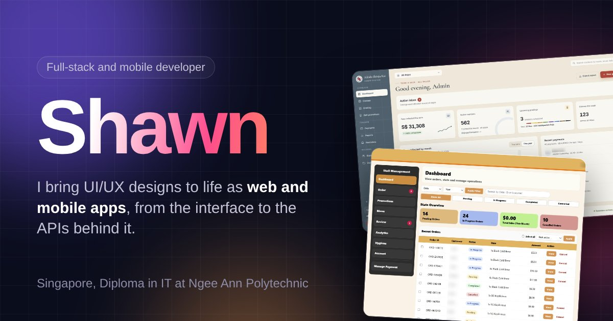

# Shawn | Portfolio

Personal portfolio of Shawn, a full-stack and mobile developer based in Singapore.

**Live site:** [add your Vercel link here](https://example.com)



## About

A single-page portfolio covering my projects, experience, awards, certifications and resume. It's hand-built with plain HTML, CSS and JavaScript, with no frameworks or build step.

## Features

- Scroll-aware navigation that highlights the current section, with a scroll progress bar
- Project screenshot galleries with a full-size lightbox and keyboard support
- Animated hero with a typing effect and count-up stats
- Responsive layout with a mobile menu
- Respects the visitor's reduced-motion setting
- Link preview card and favicon for sharing

## Featured projects

- **HawkerPoint**: hawker centre ordering and management platform (Node.js, Express, SQL Server)
- **Aikido Shinju-Kai admin system**: multi-dojo admin system for a real client (Next.js, Node.js, Stripe)
- **Serverless on AWS**: image watermarking pipeline and product API (Lambda, S3, SNS, DynamoDB)
- **Changi Reunite**: systems analysis and UML design for a lost-and-found platform

## Project structure

```
├── index.html      Page content
├── css/
│   └── style.css   Styles
├── js/
│   └── main.js     Interactions
├── img/            Screenshots, icons and preview image
└── resume.pdf      Resume
```

## Running locally

No install needed. Open `index.html` in a browser, or serve the folder:

```
npx serve .
```

## Deployment

Deployed on Vercel. Every push to `main` redeploys the site automatically.

## Contact

- Email: hoshawn77@gmail.com
- LinkedIn: [linkedin.com/in/shawnn-ho](https://www.linkedin.com/in/shawnn-ho/)
- GitHub: [github.com/Shawnnho](https://github.com/Shawnnho)

---

© Shawn. All rights reserved.
